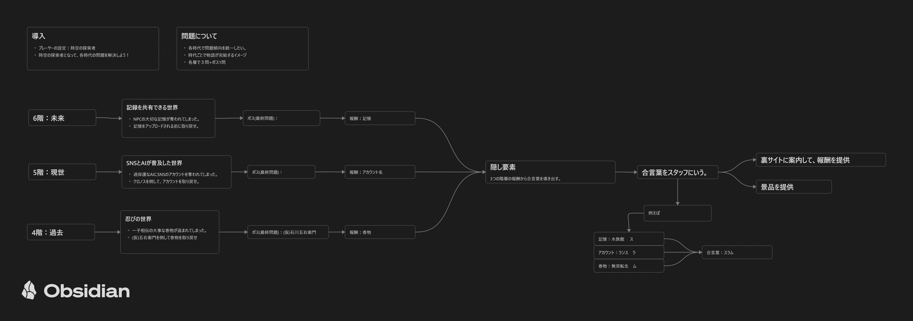

# 【企画書】専門部1_謎解き【Vantan文化祭2026】

## 企画タイトル
**【謎解き＋探索】クロノス-ログ**

## 企画内容
4階～6階のあちこちにQRコードを配置して、  
読み込むとWebページに飛んで謎解きの問題や問題のヒントが出題される。  
問題を解いて、クリアを目指す。  

## 企画詳細  
- 10問程度を想定
- 各階に様々なところに、QRコードを配置する。(教室内や混雑しそうな場所は避ける)
- 受付用のメインQRコードは、各階の目に入りそうなところに設置して、ログインをしてもらってスタート
- メンバーはその辺にふらつててもいいので、プレイヤーにヒントを出したり、案内をする。
- クリア後に、景品か得点を用意したい。隠しステージなのでも容易したい。
- フロントエンド：HTML、CSS、JS
- バックエンド：検討中

## 企画テーマ

