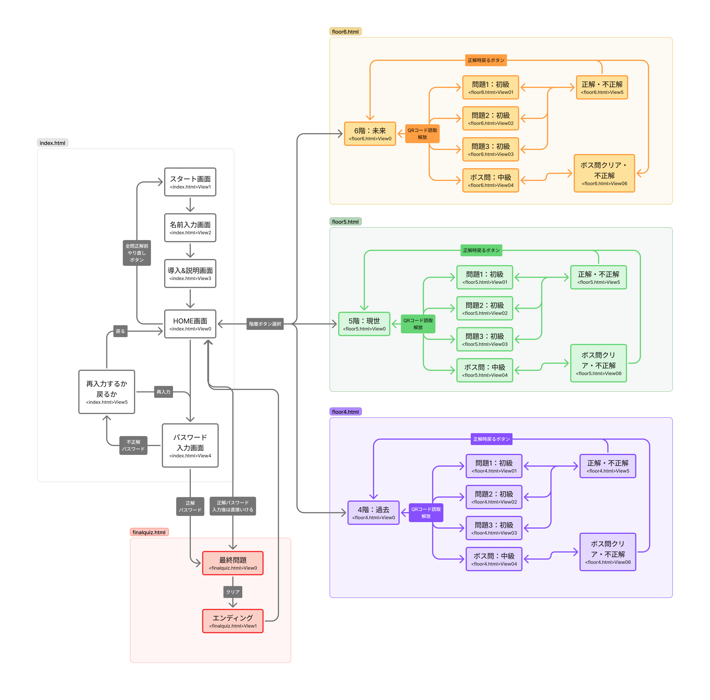

# 【謎解き＋探索】クロノス-ログ (Vantan文化祭2026)

## 1. アプリ概要
2026年度バンタン文化祭用に制作する、スマートフォン向け謎解きWebアプリです。会場の4階〜6階に隠されたQRコードを探し出し、スマートフォンで読み込むことで問題に挑戦し、各階のインシデント（事件）を解決していきます。

- **問題数:** 各階 初級問題3問 ＋ ボス問1問 の計12問。
- **隠し要素:** 全3階層のボス問の答え（Logキーワード）を組み合わせることでパスワードが完成。最終問題（＋2問）へ挑戦可能になります。

## 2. アプリ体験の流れ（ゲームフロー）
1. **スタート:** 会場にあるメインQRコードをスマホで読み込み、アプリにアクセスする。
2. **導入・ログイン:** スタート画面で名前（name）を入力。時空管理局AI「クロノス」からのメッセージを読み、ゲームの目的を理解する。
3. **探索と謎解き:** 校内を巡り、隠されたQRコードをアプリ内のQRコードリーダーで読み込む（QRコードには問題解放用の暗号が仕込まれている）。
4. **ボスへの挑戦:** 各階で初級問題を3問解き、ボス用QRコードを読み込むとボス問が解放される。
5. **クリア（ノーマルエンド）:** すべての階層のボス問をクリアすると「ノーマルエンド」。クリア画面をスタッフに見せて景品（お菓子など）を受け取る。
6. **最終問題（トゥルーエンド）:** 各ボスから得た「Logキーワード」を組み合わせ、パスワードを導き出す。HOME画面の「初めからやり直す」ボタンからパスワードを入力すると、隠された最終問題へ。正解すればトゥルーエンドとなり、豪華景品がもらえる。

## 3. 各階層のストーリー・設定
プレイヤーは「時空の探索者」として、各時代の問題を解決しよう！ 
詳しくは [[ストーリーライン参照](./docs/クロノスログ_ストーリーライン.md)]
### 6階：未来（記憶の売買する世界）
- **インシデント:** NPCの大切な記憶が奪われてしまった。記憶をアップロードされる前に取り戻せ。
- **登場人物:** クロエ、敵、ボス
- **Logキーワード:** クロエの記憶

### 5階：現世（SNSとAIが普及した世界）
- **インシデント:** 過保護なAIにSNSのアカウントを奪われてしまった。凍結したアカウントを取り戻せ。
- **登場人物:** 鈴木 栞、Z(某SNSアプリ)
- **Logキーワード:** 鈴木 栞(すずき しおり)の裏垢

### 4階：過去（書物の世界）
- **インシデント:** 一子相伝の大事な巻物が盗まれてしまった。巻物を取り戻せ。
- **登場人物:** 斥候1〜3、ボス
- **Logキーワード:** 狭間(はざま)流の秘伝書

## 4. 画面遷移とページ構成
[[Figma - クロノス-ログページ遷移](https://www.figma.com/board/OAenKB2H7oE6jMUHKWxHHO/%E3%82%AF%E3%83%AD%E3%83%8E%E3%82%B9-%E3%83%AD%E3%82%B0%E7%94%BB%E9%9D%A2%E9%81%B7%E7%A7%BB%E5%9B%B3?node-id=0-1&t=T7jBETb8dYTMyyGm-1)]
| ファイル名 | 役割・画面 |
| :- | :- |
| `index.html` | スタート画面、名前入力、導入説明、HOME画面、パスワード入力 |
| `floor6.html` | 6階（未来）の謎解き画面（問題1〜3、ボス問、正解/不正解表示） |
| `floor5.html` | 5階（現世）の謎解き画面（問題1〜3、ボス問、正解/不正解表示） |
| `floor4.html` | 4階（過去）の謎解き画面（問題1〜3、ボス問、正解/不正解表示） |
| `finalquiz.html` | 最終問題画面、エンディング画面 |

## 5. 使用する主な技術・ツール
| 技術・ツール | 用途・説明 |
| :- | :- |
| **HTML / CSS / JS** | フロントエンド開発言語。動的サーバーは使用せず、すべてブラウザ上で動作させる。 |
| **html5-qrcode** | JavaScriptライブラリ。Webブラウザ内でカメラを起動し、問題解放用QRコードを読み込むために使用。 |
| **LocalStorage** | ブラウザの保存機能。プレイヤーの名前、問題解放フラグ、回答状況、Logキーワードの取得状態を保存。 |
| **Dialog要素** | HTML5のネイティブ要素。QRコードリーダーの起動画面や、クリア時のポップアップ画面に使用。 |
| **ハッシュ化 (SHA-256等)** | 答えのネタバレ防止。JSファイル内に直接答えを書かず、ハッシュ値で正誤判定を行う。 |

## 6. デプロイ（公開）環境
- **GitHub Pages:** データベースを使用しないフロントエンド完結アプリのため、GitHubにコードをプッシュするだけで無料でWeb公開できるGitHub Pagesを使用する。

## 7. チーム開発・コーディングルール
- **命名規則:**
  - **HTML, CSS (クラス名・ID名):** ケバブケース（例: `btn-primary`, `header-title`）
  - **JavaScript (変数名・関数名):** ローワーキャメルケース（例: `userName`, `checkAnswer()`）
- **Git/GitHubの運用:**
  - `main` ブランチには直接保存（コミット）しないこと。
  - 作業時は必ず新しいブランチを作成し、Pull Requestを通じて合流させること。